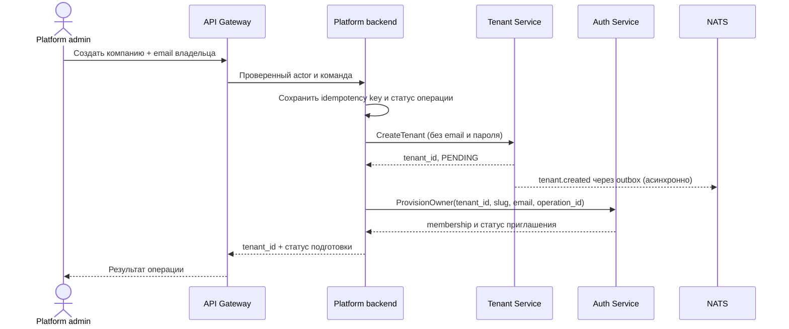

# Взаимодействие Auth Service и Tenant Service

**Статус:** проектный анализ этапов B и C; этап B реализован в ветке `feat/auth-tenant-provisioning`, этап C остаётся целевым контрактом.
**Дата сверки:** 2026-10-28.
**Основа:** [Auth Service STPO](services/auth-service/ReserveHub-Auth-Service-STPO.md), [Tenant Service Specification](services/tenant-service/ReserveHub-Tenant-Service-Full-Specification.md), [топология сервисов](architecture/communication-topology.md), [MVP](architecture/ReserveHub-MVP.md).

> Разделы «Что работает сейчас», «Бизнес-сценарии» и «Порядок работ» ниже сохраняют проектный срез от 2026-10-27. Их пометки «не реализовано» относятся к состоянию до этапа B. Актуальный контракт Auth и Admin описан в [Auth README](../services/auth-service/README.md) и [Admin README](../services/admin-service/README.md); результаты проверки — в [QA отчёте](qa/auth-tenant-business-process-2026-10-28.md). Реализованы provisioning, доставка и принятие приглашения, refresh/logout, live статус Admin и audit outbox. Tenant остаётся `PENDING` после принятия; tenant-scoped авторизация и gate активации относятся к этапу C.

## 1. Граница ответственности

| Вопрос | Источник истины | Что хранит и решает |
| --- | --- | --- |
| Кто вошёл? | `auth-service` | Пользователь, credentials, глобальная роль, учётная сессия и подпись токена. |
| В каких компаниях состоит пользователь? | `auth-service` — целевое состояние | Приглашения, tenant membership, профиль прав и их отзыв. Сейчас membership ещё нет. |
| Что представляет собой компания? | `tenant-service` | `tenant_id`, slug, жизненный цикл, настройки, план, лимиты, флаги, домены и branding. |
| Можно ли выполнить действие внутри компании? | Сервис, выполняющий действие | Проверяет личность и членство из доверенного контекста, разрешение на операцию, `tenant_id` ресурса и применимый статус Tenant. |

В Compose оба сервиса используют один физический PostgreSQL, но разные схемы (`auth_service` и `tenant_service`). Общая физическая БД не делает их общим владельцем данных: сервисы не должны читать таблицы друг друга или связывать создание компании и владельца одной межсервисной SQL-транзакцией. Gateway является публичной точкой входа, а Tenant остаётся во внутренней сети.

## 2. Что работает сейчас

1. Клиент вызывает через `api-gateway` только `POST /v1/auth/register`, `POST /v1/auth/login` и `GET /v1/auth/me`. Публичная регистрация создаёт глобального `user`; первый `admin` создаётся отдельным bootstrap-процессом. Gateway не маршрутизирует Tenant RPC.
2. Auth подписывает 15-минутный JWT ключом Ed25519. В нём есть `sub`, глобальные `role` и `scope`, `aud`, `iss`, `iat`, `exp`; **нет** подтверждённого `tenant_id`, membership или permissions. Приватный ключ получает только Auth, публичный — Gateway и Tenant. Локальные пути к ним показаны в [`.env.example`](../.env.example).
3. Tenant проверяет подпись, issuer, audience `reservehub-tenant`, срок и роль. Все защищённые Tenant RPC сейчас доступны только токену с `scope=platform` и `role=admin`; health check публичный. Обычный `user`, в том числе предполагаемый будущий владелец, доступа пока не имеет.
4. `CreateTenant` создаёт компанию в `PENDING`, её настройки, branding, назначение плана и запись `tenant.created` в одной транзакции. Запрос [gRPC-контракта](../services/tenant-service/proto/tenant/v1/tenant.proto) не принимает email владельца. Событие не содержит email, и потребителя для создания владельца в Auth сейчас нет.
5. В Auth уже есть таблица tenant-scoped **ролей**, но нет таблицы membership, приглашений и операции provision owner. `users.role_id` хранит только одну роль, а текущие потоки регистрации и bootstrap назначают platform role. Поле `password_hash NOT NULL` не представляет учётную запись приглашённого без заранее заданного пароля. Для целевого процесса нужны отдельные миграции и модель состояний.
6. Tenant публикует события через outbox/NATS, но между Auth и Tenant сейчас нет прямого синхронного вызова. Их действующая интеграция — JWT, подписанный Auth и проверенный Tenant.

> В разделе «Текущая реализация» Auth STPO ещё упоминается HS256. Фактический код и `.env.example` используют **EdDSA/Ed25519**; при реализации новых контрактов опираться следует на действующий формат токена и обновить этот фрагмент STPO.

## 3. Бизнес-сценарии

| ID | Сценарий | Требуемый результат | Состояние |
| --- | --- | --- | --- |
| AT-01 | Человек регистрируется и входит | Одна глобальная identity с ролью `user`; вход не даёт доступ к произвольной компании. | Реализовано. |
| AT-02 | Платформенный администратор создаёт компанию | Tenant сохраняет компанию `PENDING` и событие; администратор видит `tenant_id` и статус подготовки владельца. | Создание Tenant реализовано только через внутренний gRPC; публичный административный процесс и статус подготовки отсутствуют. |
| AT-03 | Назначается первый владелец новой компании | Auth создаёт tenant-scoped роль и membership `tenant_owner`, приглашает владельца; повтор команды не создаёт дубликатов. | Не реализовано. |
| AT-04 | Email владельца уже зарегистрирован | Существующая identity получает приглашение в новую компанию; активное членство появляется после подтверждения владельцем email или в аутентифицированной сессии. | Не реализовано. |
| AT-05 | Владелец выбирает компанию и читает её данные | Сервер проверяет активное членство и разрешение для конкретного `tenant_id`; данные других компаний недоступны. | Не реализовано. |
| AT-06 | Владелец приглашает сотрудника или отзывает доступ | Права сотрудника ограничены его компанией и профилем (`tenant_viewer`, позднее `tenant_manager`); отзыв перестаёт давать доступ в оговорённый срок. | Не реализовано. |
| AT-07 | Компания приостановлена или архивирована | Membership остаётся учётной записью доступа, но операции также подчиняются статусу Tenant: при `SUSPENDED` tenant-specific writes запрещены, при `ARCHIVED` обычные операции недоступны. | Запрет записей в Tenant реализован для текущих RPC; сквозной доступ участников ещё не реализован. |
| AT-08 | Slug компании изменился | Tenant меняет slug; код tenant-scoped роли, присвоенный при создании, автоматически не меняется и продолжает ссылаться на неизменный `tenant_id`. | Правило описано в Auth STPO; provision роли ещё нет. |

## 4. Целевой процесс создания компании и владельца

Оркестратор административной операции — отдельный `admin-service` **или** иной защищённый platform backend. Его выделение в самостоятельный микросервис ещё не утверждено. Gateway не подключают к `tenant-internal` ради прямого вызова Tenant из браузера.

Требования к шагам:

1. Операция доступна только платформенному администратору; backend проверяет также **сервисную identity** при внутренних вызовах. Передача пользовательского bearer token сама по себе не аутентифицирует сервис.
2. Оркестратор хранит email владельца в защищённом контексте команды и связывает его с `operation_id`/idempotency key. Пароль не передаётся Tenant, а email не помещается в широковещательное `tenant.created`. События Tenant не заменяют защищённую команду provision, поскольку не содержат владельца.
3. Tenant остаётся источником истины для `tenant_id` и slug. Auth создаёт роль, привязанную к **неизменному `tenant_id`**, с начальным кодом slug; само совпадение строки роли с slug не выдаёт прав.
4. Auth в одной своей транзакции идемпотентно связывает identity, tenant-scoped роль, membership и приглашение. Для существующего email членство не должно становиться активным без подтверждения. Инвайт одноразовый; пароль при создании новой identity задаётся владельцем, а не администратором платформы.
5. Оркестратор отдельно показывает состояние provisioning и повторяет временные сбои с тем же ключом. После сбоя Auth компания остаётся видимой как `PENDING`/неподготовленная; автоматическое удаление Tenant не требуется. Повтор не создаёт вторую компанию, роль, identity или membership.
6. До provision роли и membership компания не считается полностью подготовленной. Точный момент разрешённой активации — после создания приглашения либо после его принятия — требует продуктового решения; его нельзя незаметно кодировать только проверкой `tenant.status`.

`CreateTenant` пока не поддерживает idempotency key. Для безопасного повтора оркестратор должен сохранять полученный `tenant_id` и результат операции; перед внедрением повторного `CreateTenant` нужен контракт идемпотентности. Совпадение slug само по себе не доказывает, что повтор относится к той же команде.

## 5. Авторизация после появления membership

Пользователь выбирает компанию из списка **подтверждённых** членств. Перед выполнением запроса backend проверяет `user_id`, `tenant_id`, статус членства и permission; клиентский `tenant_id` служит только запросом на выбор, а не доказательством права. В каждый бизнес-сервис передаётся проверенный контекст, и сам сервис сопоставляет его с `tenant_id` ресурса. Статус компании и применимость тарифа/флагов берутся у Tenant либо из контролируемой версии его read model.

| Субъект | Целевой доступ к Tenant |
| --- | --- |
| Platform `admin` | Платформенные операции над компаниями по явной политике RPC, с аудитом actor и цели. |
| `user` без активного membership | Нет доступа к tenant-данным. |
| `tenant_viewer` | Только разрешённое чтение своей компании. |
| `tenant_owner` | Разрешённые действия внутри своей компании; создание других компаний, глобальный список и платформенное управление не следуют из роли владельца. |

Текущий JWT не содержит выбранный tenant и membership. Для этапа C нужно утвердить контракт проверки: запрос к Auth на каждый критичный вызов, короткоживущий подписанный tenant context либо сочетание с ограниченным кешем и явным правилом отзыва. Роль `admin` платформы нельзя использовать для выдачи полномочий владельцу. Отмена членства и изменение прав должны отражаться в авторизации в документированный срок; срок действия текущего access token — до 15 минут.

## 6. Предлагаемые межсервисные контракты

Это требования для проектирования, **не описание доступных endpoint-ов**.

| Контракт | Вход и результат | Условие безопасности |
| --- | --- | --- |
| Команда платформенного создания компании | Данные Tenant, email первого владельца, actor, idempotency key → `tenant_id`, статус provisioning. | Только platform admin через Gateway и доверенный backend. Email остаётся в защищённой команде. |
| Внутренний `ProvisionOwner` в Auth | `tenant_id`, исходный slug, нормализованный email, operation ID → identity/membership/invitation ID и статус. | Сервисная аутентификация; запрет публичного маршрута; идемпотентность по операции и уникальным ключам. |
| Проверка членства/прав | Проверенный `user_id`, выбранный `tenant_id`, требуемое действие → статус и разрешения. | Нельзя доверять лишь заголовку или `tenant_id` из тела; окончательная проверка ресурса остаётся у сервиса-владельца. |
| `tenant.created` и события статуса | `event_id`, версия схемы, `tenant_id`, тип, время, безопасные данные компании. | Без email владельца и credentials; потребители учитывают повторную доставку. |

Для новых внутренних команд определить deadline, поведение при недоступности Auth/Tenant, ключ идемпотентности, допустимые повторы, права вызывающего сервиса и корреляцию логов/трасс. У Auth и Tenant нет общей транзакции даже при общей физической БД.

## 7. Приёмочные проверки интеграции

1. Публичная регистрация всегда создаёт только глобального `user`; поле `role` или `tenant_id` в запросе не выдаёт привилегий.
2. Платформенный admin создаёт один Tenant и одно provision-задание; повтор той же команды возвращает тот же результат и не создаёт дубликатов.
3. У нового Tenant есть ровно одна связанная tenant-scoped роль с исходным slug и одна запись членства первого владельца; изменение slug не переназначает роль автоматически.
4. Существующий пользователь с тем же email не получает доступ до принятия приглашения; новая identity не требует пароля, выбранного администратором.
5. Пользователь без membership, с чужим membership, с отозванным membership либо с ролью viewer не выполняет запрещённые операции. Подмена `tenant_id` в URL/body/header не меняет результат.
6. При недоступности Auth Tenant остаётся `PENDING`, ошибка provision видна администратору, повтор завершается без дублей. Email и токены отсутствуют в публичных событиях и логах.
7. При `SUSPENDED` tenant-specific writes блокируются независимо от членства; после допустимого `ResumeTenant` доступ снова определяется активным membership. Архивированная компания не выполняет обычные бизнес-операции.
8. Отзыв членства и изменение прав действуют в установленный срок; аудит содержит actor, tenant, действие и результат без паролей и токенов.

## 8. Порядок работ и открытые решения

**Ближайший инкремент (этап B):** схема memberships/invitations и модель приглашённого пользователя в Auth; защищённый идемпотентный `ProvisionOwner`; хранение статуса оркестрации и email владельца; сквозной тест создания компании и повторной попытки. Затем **этап C:** выбор tenant-контекста, проверки membership/permissions в gateway и сервисах, изоляция двух компаний.

Перед реализацией согласовать:

- какой компонент владеет административной командой и статусом provisioning; отдельный `admin-service` пока лишь предлагается архитектурой;
- когда Tenant можно активировать: после provision приглашения или после его принятия;
- как передавать и обновлять проверенный tenant context, включая задержку отзыва прав;
- кто доставляет приглашение, каков его TTL и как существующий пользователь подтверждает добавление компании;
- допускается ли чтение данных `SUSPENDED` компании для owner/viewer и как прекращается доступ к `ARCHIVED`;
- какие права сервисной identity нужны оркестратору и как защищается внутренний транспорт.
